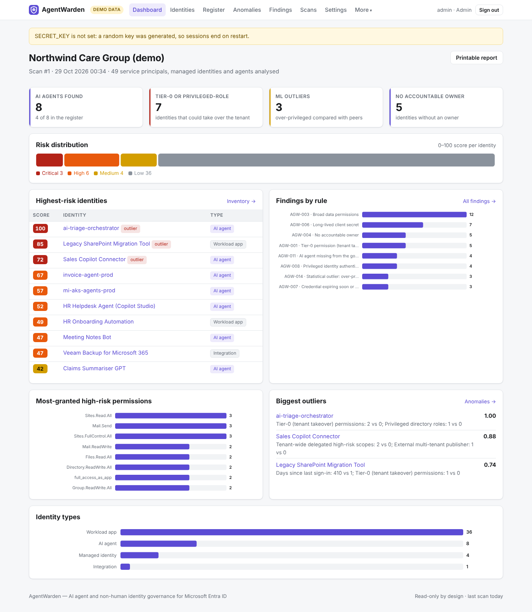
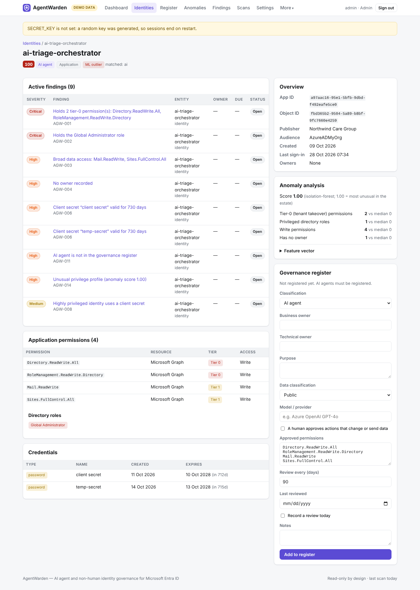
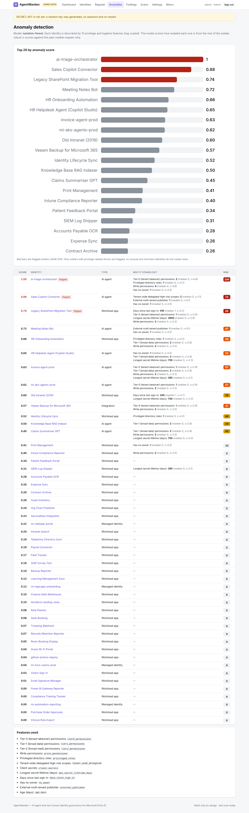

# AgentWarden

**AI agent and non-human identity governance for Microsoft Entra ID.** AgentWarden inventories every service
principal, managed identity and AI agent in your tenant, shows what each one can reach, and uses machine learning
to flag identities that are over-privileged compared with their peers — with an explanation for every flag.

[](https://github.com/OWNER/agentwarden/actions/workflows/ci.yml)




## Why

Organisations are putting AI agents into production (Copilot Studio, Azure OpenAI apps, custom agents on AKS).
Each one is a non-human identity with application permissions, secrets and often no human owner. A single
prompt-injected agent with `Mail.Send` or `Files.ReadWrite.All` — or a leaked secret for an app holding
`RoleManagement.ReadWrite.Directory` — is a tenant-wide incident. Workload identities cannot do MFA and are
outside most Conditional Access policies.

## What it does

- **Inventory** — service principals, managed identities, third-party multi-tenant apps and AI agents
  (classified by configurable keywords, or explicitly in the register).
- **Permission tiers** — every application permission is tiered: Tier 0 (tenant takeover), Tier 1 (broad data
  access), Tier 2 (broad read), Tier 3 (scoped). Extend the tiers in Settings.
- **Risk score 0–100** per identity combining privilege, roles, ownership, credential hygiene, activity,
  third-party exposure, register status and ML outlier status.
- **ML anomaly detection** — an Isolation Forest over 12 privilege/hygiene features per identity. Robust
  z-scores against the peer median explain *why* each identity stands out ("Tier-0 permissions: 2 vs median 0").
  Only outliers with privilege-related drivers are flagged, to keep noise down. Falls back to a dependency-free
  robust-z model for small estates.
- **Governance register** — purpose, business/technical owner, data classification, model provider,
  human-in-the-loop, approved permissions and review cadence for each agent. Approved permissions power
  **permission drift** detection.



## Detection rules

| Rule | Severity | Category | Detects |
|---|---|---|---|
| `AGW-001` | critical | Privilege | **Tier-0 permission (tenant takeover path)** — The identity holds an application permission that can be used to grant itself or others more privilege, change authentication policy or act as any mailbox. A stolen secret or a prompt-injected agent with this permission can compromise the whole tenant. |
| `AGW-002` | critical | Privilege | **Privileged directory role on a non-human identity** — A service principal or managed identity holds a privileged Entra ID role. Workload identities cannot use MFA and are not covered by most Conditional Access policies. |
| `AGW-003` | high | Privilege | **Broad data permissions** — The identity can read or change data across the organisation (all mailboxes, all files, all chats). For AI agents this is the main data-exfiltration path if the agent is manipulated. |
| `AGW-004` | medium | Governance | **No accountable owner** — Nobody is recorded as the owner, so nobody is accountable for its permissions, secrets or retirement. |
| `AGW-005` | high | Hygiene | **Dormant identity still holds permissions** — The identity has not signed in for longer than the dormancy threshold but still holds permissions. Unused, privileged identities are attractive to attackers and easy to remove. |
| `AGW-006` | medium | Credentials | **Long-lived client secret** — A client secret is valid for longer than policy allows. Long-lived secrets leak into code, config and laptops and are rarely rotated. |
| `AGW-007` | low | Credentials | **Credential expiring soon or expired credential left behind** — A secret or certificate expires soon (risk of outage) or an expired one is still attached (clutter that hides real credentials). |
| `AGW-008` | medium | Credentials | **Privileged identity authenticates with a secret** — A highly privileged identity uses a client secret. Certificates, managed identities or workload identity federation remove the shared secret entirely. |
| `AGW-009` | high | Third party | **External multi-tenant app with high-risk access** — An application owned by another organisation has tier-0 or tier-1 access to your data. Its security is outside your control. |
| `AGW-010` | high | Consent | **Tenant-wide consent to high-risk delegated scopes** — An admin consented on behalf of all users to scopes such as Mail.Read or Files.Read.All. Any user's data can be accessed through this app while they are signed in to it. |
| `AGW-011` | medium | Governance | **AI agent missing from the governance register** — An identity that looks like an AI agent has no register entry recording its purpose, owner, data classification, model provider and approved permissions. |
| `AGW-012` | medium | Governance | **Agent access review overdue** — The last recorded review of this identity is older than its review interval. |
| `AGW-013` | high | Governance | **Permission drift beyond what was approved** — The identity holds permissions that are not on its approved list in the register. |
| `AGW-014` | medium | Anomaly | **Statistical outlier: over-privileged compared with peers** — Machine-learning (Isolation Forest) comparison of every identity's privilege and hygiene profile flags this one as unusual. The evidence lists the features that drive the score. |
| `AGW-015` | medium | Governance | **Autonomous agent with write access** — The register says this agent acts without a human approving its actions, yet it holds write permissions. Add an approval step or reduce it to read-only. |

## Quick start (demo data)

```bash
git clone https://github.com/OWNER/agentwarden.git && cd agentwarden
python -m venv .venv && source .venv/bin/activate     # Windows: .venv\Scripts\activate
pip install -e ".[dev]"
cp .env.example .env
python -m agentwarden serve
```

Open <http://127.0.0.1:8000>, sign in with `admin` / `changeme-demo`. The demo estate has 49 identities: a normal
baseline of line-of-business apps plus planted risks (an AI orchestrator holding Global Administrator, a dormant
migration tool with `Sites.FullControl.All`, a third-party connector with tenant-wide `Mail.Read` consent, agents
with permission drift).

Docker: `cp .env.example .env && docker compose up --build`.

## Connect your tenant

1. Create an Entra ID **app registration** (single tenant).
2. Add **Microsoft Graph application permissions** and grant admin consent:

   | Permission | Why |
   |---|---|
   | `Application.Read.All` | service principals, app registrations, credentials, owners, app-role assignments |
   | `Directory.Read.All` | delegated permission grants (consents) and directory objects |
   | `RoleManagement.Read.Directory` | directory role assignments held by service principals |
   | `AuditLog.Read.All` | service principal sign-in activity (needs Entra ID P1/P2) |

3. Set `DEMO_MODE=false`, `AZURE_TENANT_ID`, `AZURE_CLIENT_ID`, `AZURE_CLIENT_SECRET`, `SECRET_KEY` and
   `ADMIN_PASSWORD` in `.env`, then:

   ```bash
   python -m agentwarden check
   python -m agentwarden scan
   ```

Microsoft first-party apps are excluded by default (toggle in Settings). Sign-in activity comes from the Graph
beta `servicePrincipalSignInActivities` report; if it is unavailable the dormancy rule is skipped and the scan
says so.

## How the anomaly model works

| Feature | Notes |
|---|---|
| Tier-0 / Tier-1 / Tier-2 permission counts | from the tier catalogue |
| Write permissions | `ReadWrite`, `Send`, `FullControl`, `Manage`, … |
| Privileged directory roles | Global Admin, Privileged Role Admin, Application Admin, … |
| Tenant-wide delegated high-risk scopes | `AllPrincipals` consents to e.g. `Mail.Read` |
| Client secrets, longest secret lifetime | |
| Days since last sign-in | unknown values imputed with the median |
| No owner, external multi-tenant publisher, age | |

Features are log-scaled, an Isolation Forest (300 trees, `contamination` configurable, default 0.08) scores each
identity, and scores are normalised to 0–1. See [`agentwarden/ml.py`](agentwarden/ml.py).



## Configuration

| Variable | Default | Purpose |
|---|---|---|
| `DEMO_MODE` | `true` | `false` reads your tenant |
| `SECRET_KEY` | random per start | signs session cookies |
| `ADMIN_USERNAME` / `ADMIN_PASSWORD` | `admin` / demo only | administrator sign-in (12+ chars in live mode) |
| `VIEWER_USERNAME` / `VIEWER_PASSWORD` | `auditor` / unset | optional read-only account |
| `API_TOKEN` | unset | bearer token for the JSON API |
| `SESSION_COOKIE_SECURE` | `false` | set `true` behind HTTPS |
| `DATABASE_PATH` | `data/agentwarden.db` | SQLite file |
| `SCAN_INTERVAL_HOURS` | `0` | automatic scans |
| `AZURE_*` | — | Graph app registration |

Thresholds (dormancy, secret lifetime, AI keywords, review interval, anomaly sensitivity, extra tier-0/1
permissions) live in **Settings**.

## Architecture

```
agentwarden/
├── app.py        # product spec and entry point
├── collector.py  # Graph collection: SPs, apps, owners, app-role assignments, consents, roles, sign-ins
├── catalog.py    # permission tiers, privileged roles, AI keyword matching
├── rules.py      # governance rules + risk scoring
├── ml.py         # Isolation Forest + explainable robust z-scores
├── demo.py       # synthetic estate with a realistic baseline
├── views.py, templates/
└── core/         # shared web shell, findings lifecycle, Graph client, scanner
```

## Security

Read-only (GET-only Graph client), strict CSP, CSRF, audit log. See [SECURITY.md](SECURITY.md).

## Development

```bash
pytest -q
ruff check .
```

## Roadmap

- Microsoft Entra Agent ID support as the API matures
- Per-permission usage from sign-in/audit logs to recommend least-privilege replacements
- Peer groups by publisher/purpose for the anomaly model
- Multi-tenant MSP mode and Entra SSO for the web app

## Licence

MIT © 2026 Olatunji Kayode Jaiyeola
